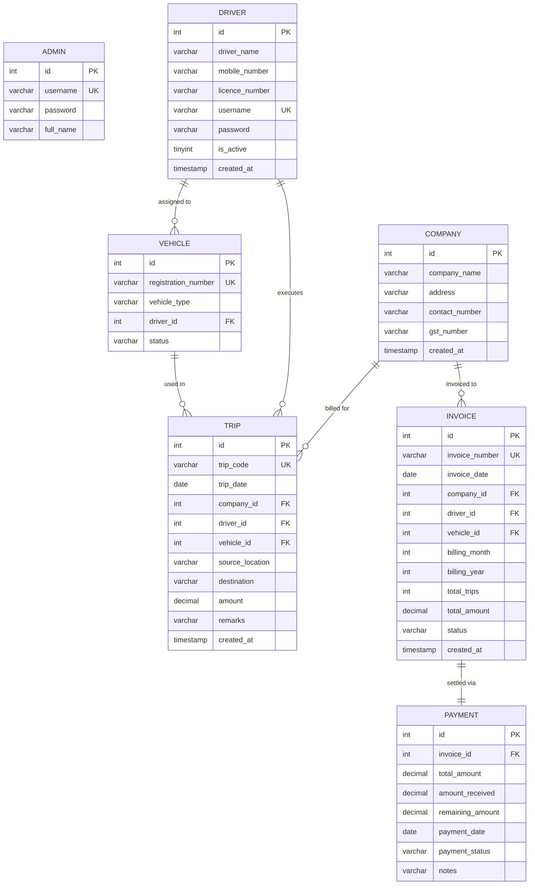

# 🗄️ Document 2: Database Design and SQL Schema

## Database Name: `transport_db`

---

## 1. Entity Relationship (ER) Diagram



---

## 2. Table Specifications & Column DDL

### Table 1: `admin`
Stores administrative user accounts with full privileges.
```sql
CREATE TABLE IF NOT EXISTS admin (
    id          INT AUTO_INCREMENT PRIMARY KEY,
    username    VARCHAR(50) UNIQUE NOT NULL,
    password    VARCHAR(100) NOT NULL,
    full_name   VARCHAR(100)
);
```

### Table 2: `company`
Stores client companies transported for.
```sql
CREATE TABLE IF NOT EXISTS company (
    id              INT AUTO_INCREMENT PRIMARY KEY,
    company_name    VARCHAR(100) NOT NULL,
    address         VARCHAR(200),
    contact_number  VARCHAR(15),
    gst_number      VARCHAR(20),
    created_at      TIMESTAMP DEFAULT CURRENT_TIMESTAMP
);
```

### Table 3: `driver`
Stores driver profile, credentials, and active state.
```sql
CREATE TABLE IF NOT EXISTS driver (
    id              INT AUTO_INCREMENT PRIMARY KEY,
    driver_name     VARCHAR(100) NOT NULL,
    mobile_number   VARCHAR(15),
    licence_number  VARCHAR(20),
    username        VARCHAR(50) UNIQUE NOT NULL,
    password        VARCHAR(100) NOT NULL,
    is_active       TINYINT(1) DEFAULT 1,
    created_at      TIMESTAMP DEFAULT CURRENT_TIMESTAMP
);
```

### Table 4: `vehicle`
Stores fleet vehicle registration, type, and driver assignment.
```sql
CREATE TABLE IF NOT EXISTS vehicle (
    id                  INT AUTO_INCREMENT PRIMARY KEY,
    registration_number VARCHAR(20) UNIQUE NOT NULL,
    vehicle_type        VARCHAR(50),
    driver_id           INT,
    status              VARCHAR(20) DEFAULT 'Active',
    FOREIGN KEY (driver_id) REFERENCES driver(id) ON DELETE SET NULL
);
```

### Table 5: `trip`
The core transactional ledger storing daily operational trips.
```sql
CREATE TABLE IF NOT EXISTS trip (
    id                  INT AUTO_INCREMENT PRIMARY KEY,
    trip_code           VARCHAR(20) UNIQUE NOT NULL,
    trip_date           DATE NOT NULL,
    company_id          INT NOT NULL,
    driver_id           INT NOT NULL,
    vehicle_id          INT NOT NULL,
    source_location     VARCHAR(100) NOT NULL,
    destination         VARCHAR(100) NOT NULL,
    amount              DECIMAL(10,2) NOT NULL,
    remarks             VARCHAR(200),
    created_at          TIMESTAMP DEFAULT CURRENT_TIMESTAMP,
    FOREIGN KEY (company_id) REFERENCES company(id),
    FOREIGN KEY (driver_id)  REFERENCES driver(id),
    FOREIGN KEY (vehicle_id) REFERENCES vehicle(id)
);
```

### Table 6: `invoice`
Stores monthly finalized invoices generated for clients.
```sql
CREATE TABLE IF NOT EXISTS invoice (
    id              INT AUTO_INCREMENT PRIMARY KEY,
    invoice_number  VARCHAR(20) UNIQUE NOT NULL,
    invoice_date    DATE NOT NULL,
    company_id      INT NOT NULL,
    driver_id       INT,
    vehicle_id      INT,
    billing_month   INT NOT NULL,
    billing_year    INT NOT NULL,
    total_trips     INT DEFAULT 0,
    total_amount    DECIMAL(10,2) DEFAULT 0.00,
    status          VARCHAR(20) DEFAULT 'Generated',
    created_at      TIMESTAMP DEFAULT CURRENT_TIMESTAMP,
    FOREIGN KEY (company_id) REFERENCES company(id)
);
```

### Table 7: `payment`
Stores payment transaction tracking linked one-to-one to each invoice.
```sql
CREATE TABLE IF NOT EXISTS payment (
    id               INT AUTO_INCREMENT PRIMARY KEY,
    invoice_id       INT NOT NULL UNIQUE,
    total_amount     DECIMAL(10,2) NOT NULL,
    amount_received  DECIMAL(10,2) DEFAULT 0.00,
    remaining_amount DECIMAL(10,2) DEFAULT 0.00,
    payment_date     DATE,
    payment_status   VARCHAR(20) DEFAULT 'Pending',
    notes            VARCHAR(200),
    FOREIGN KEY (invoice_id) REFERENCES invoice(id)
);
```

---

## 3. Relational Constraints & Data Integrity

1. **Foreign Key Integrity:**
   - Every trip must reference a valid `company_id`, `driver_id`, and `vehicle_id`. It is impossible to log an orphaned trip.
   - If a driver account is deleted, vehicles assigned to that driver have their `driver_id` safely set to `NULL` (`ON DELETE SET NULL`) rather than corrupting vehicle records.
2. **Unique Constraints:**
   - `admin.username` and `driver.username` are enforced UNIQUE to prevent identity collisions.
   - `vehicle.registration_number` is UNIQUE to prevent registering duplicate vehicle plates.
   - `trip.trip_code` and `invoice.invoice_number` are UNIQUE to ensure auditability.
3. **Data Types:**
   - Financial sums (`amount`, `total_amount`, `amount_received`, `remaining_amount`) use `DECIMAL(10, 2)` instead of floating-point `FLOAT` or `DOUBLE` in MySQL to prevent floating-point rounding errors.
